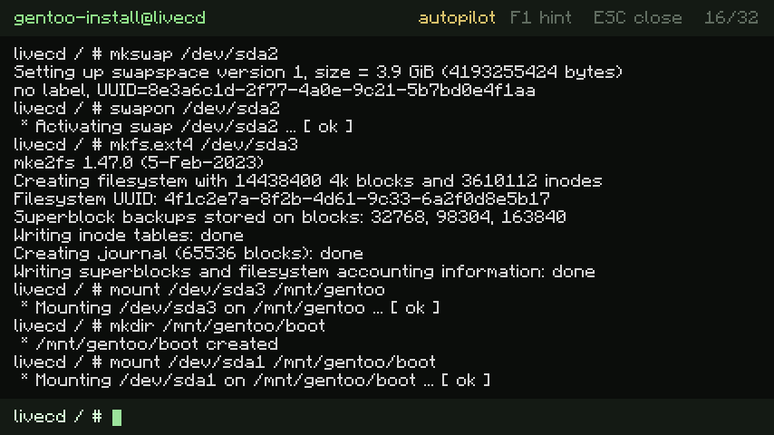
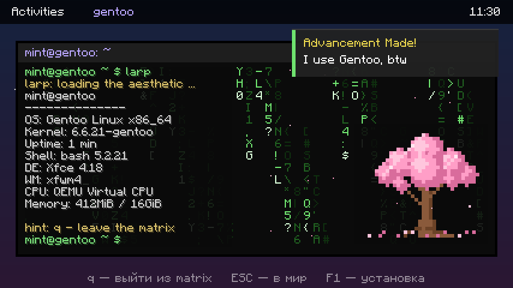
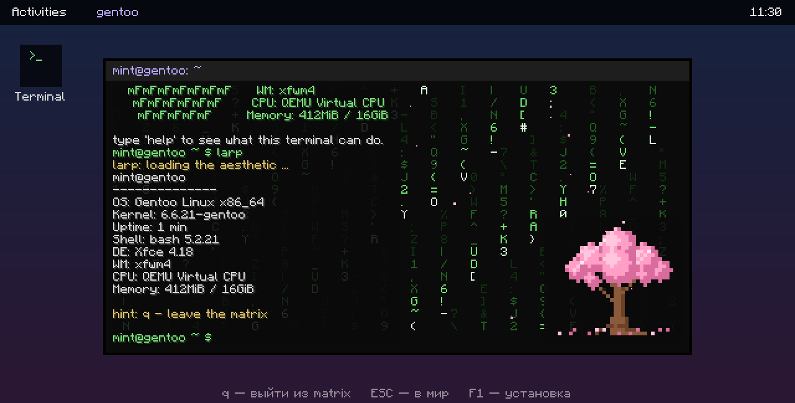

# Gentoo Install Simulator

[English](#english) · [Русский](#russian)

<a id="english"></a>

## English

A Fabric 1.21 client mod that puts a working terminal inside Minecraft: you install **Gentoo Linux**
by hand, the same way you would on a real machine — `parted`, `mkfs`, stage3, `chroot`, `emerge`,
kernel, GRUB. Nothing is done for you: every command has to be typed, and a wrong command answers
with a real `bash: ...: command not found`.

When the machine finally reboots you get the **“I use Gentoo, btw”** achievement and a Gentoo
desktop with `neofetch`.

### Screenshots

| The install | The desktop |
| --- | --- |
|  |  |

`larp` - cmatrix, neofetch and a cherry tree:



### Requirements

| | |
| --- | --- |
| Minecraft | **1.21** (Java Edition) |
| Loader | **Fabric Loader 0.20.1** or newer |
| Dependency | **[Fabric API](https://modrinth.com/mod/fabric-api)** for 1.21 |
| Java | 21 or newer |
| Side | **Client only** — works on any server, nothing is sent to it |

### Install

1. Install Fabric Loader for Minecraft 1.21.
2. Put **Fabric API** and **`gentoo-mod-1.2.0.jar`** into `.minecraft/mods`.
3. Press **G** in game (rebindable in *Options → Controls → Key Binds → Misc*).

### Controls

| Key | Action |
| --- | --- |
| **G** | open / close the terminal |
| **F1** | hint: the exact command for the current step |
| **Enter** | run the command |
| **↑ / ↓** | command history |
| **PgUp / PgDn / mouse wheel** | scroll the output |
| **Ctrl+V** | paste (the whole list below can be pasted one by one) |
| **Esc** | close (progress is saved) |

Useful shell commands that are not part of the install: `help`, `clear`, `reset`, `autopilot`, `ls`, `pwd`,
`whoami`, `uname -a`, `cat /etc/os-release`, `neofetch`, `date`.

### The install, step by step

Copy them in this order. `help` always shows the next one.

```bash
ip a
ping -c 3 gentoo.org
parted -a optimal /dev/sda mklabel gpt
parted /dev/sda mkpart primary fat32 1MiB 513MiB
parted /dev/sda mkpart primary linux-swap 513MiB 4608MiB
parted /dev/sda mkpart primary ext4 4608MiB 100%
parted /dev/sda set 1 esp on
parted /dev/sda print
mkfs.vfat -F32 /dev/sda1
mkswap /dev/sda2
swapon /dev/sda2
mkfs.ext4 /dev/sda3
mount /dev/sda3 /mnt/gentoo
mkdir /mnt/gentoo/boot
mount /dev/sda1 /mnt/gentoo/boot
cd /mnt/gentoo
tar xpvf stage3-amd64-openrc.tar.xz --xattrs-include='*.*' --numeric-owner
cp --dereference /etc/resolv.conf /mnt/gentoo/etc/resolv.conf
chroot /mnt/gentoo /bin/bash
source /etc/profile
emerge-webrsync
emerge --ask sys-kernel/gentoo-sources
emerge --ask sys-kernel/installkernel sys-boot/grub
cd /usr/src/linux
make -j8
make modules_install
grub-install --target=x86_64-efi --efi-directory=/boot --bootloader-id=Gentoo
grub-mkconfig -o /boot/grub/grub.cfg
passwd
useradd -m -G wheel -s /bin/bash mint
exit
reboot
```

### Watch mode (autopilot)

Don't want to type 32 commands? Open the terminal and type `autopilot` — the shell then types the
whole install by itself, at a readable pace, and opens the desktop with the achievement when it is
done. It switches itself off on the last step. Press **Enter** (or type `autopilot`) to take over /
turn it back on; `reset` wipes the disk and turns it off.

### The desktop terminal

After the reboot the desktop is not a picture: the window is a live shell. Type in it, press Enter.

| command | what it does |
| --- | --- |
| `help` | list of commands |
| `neofetch` | system info |
| `cmatrix` | matrix rain, `q` to quit |
| `larp` | cmatrix + neofetch + sakura at once |
| `sakura` | the tree |
| `sudo rm -rf /` | asks for a password (any), then hits the `--preserve-root` failsafe |
| `ls`, `pwd`, `whoami`, `date`, `uname -a`, `cat /etc/os-release` | the usual |
| `achievement` | replay the toast and the sound |
| `clear` | wipe the screen |
| `exit` | back to the world |

`Ctrl+V` pastes here too. **Esc** leaves the desktop (press **G** to come back, **F1** — the install
terminal). While the matrix is running, **q**, **Esc** or **Space** stops it.

### Saving

Everything (current step, chroot state, scrollback, command history) is written to
`config/gentoo-mod.json` after every command, so closing the screen, leaving the world or restarting
the game does not lose progress. `reset` in the terminal wipes the disk and starts over.

### Build

```bash
./gradlew build          # Windows: gradlew.bat build
```

Loom 1.19 needs **JDK 25** to run Gradle; the mod itself targets Java 21. The jar lands in
`build/libs/`.

### License

CC0.

<br>

---

<a id="russian"></a>

## Русский

Клиентский мод для Fabric 1.21, который превращает Minecraft в компьютер с настоящим терминалом:
ты ставишь **Gentoo Linux** руками — ровно как на живой машине: `parted`, `mkfs`, stage3, `chroot`,
`emerge`, ядро, GRUB. За тебя ничего не делается: каждую команду надо набрать, а на ошибку шелл
отвечает честным `bash: ...: command not found`.

Когда машина наконец перезагрузится — дают ачивку **«I use Gentoo, btw»** и открывается рабочий
стол Gentoo с `neofetch`.

### Скриншоты

| Установка | Рабочий стол |
| --- | --- |
|  |  |

`larp` - cmatrix, neofetch и цветущая сакура:


### Требования

| | |
| --- | --- |
| Minecraft | **1.21** (Java Edition) |
| Загрузчик | **Fabric Loader 0.20.1** или новее |
| Зависимость | **[Fabric API](https://modrinth.com/mod/fabric-api)** для 1.21 |
| Java | 21 или новее |
| Сторона | **Только клиент** — работает на любом сервере, на сервер ничего не уходит |

### Установка

1. Поставить Fabric Loader для Minecraft 1.21.
2. Положить **Fabric API** и **`gentoo-mod-1.2.0.jar`** в `.minecraft/mods`.
3. Нажать **G** в игре (переназначается в *Настройки → Управление → Клавиши → Разное*).

### Управление

| Клавиша | Действие |
| --- | --- |
| **G** | открыть / закрыть терминал |
| **F1** | подсказка: точная команда для текущего шага |
| **Enter** | выполнить команду |
| **↑ / ↓** | история команд |
| **PgUp / PgDn / колесо мыши** | прокрутка вывода |
| **Ctrl+V** | вставить (список ниже можно вставлять по одной) |
| **Esc** | закрыть (прогресс сохраняется) |

Полезные команды, не относящиеся к установке: `help`, `clear`, `reset`, `autopilot`, `ls`, `pwd`, `whoami`,
`uname -a`, `cat /etc/os-release`, `neofetch`, `date`.

### Установка по шагам

Вставляй по порядку. `help` всегда показывает следующую команду.

```bash
ip a
ping -c 3 gentoo.org
parted -a optimal /dev/sda mklabel gpt
parted /dev/sda mkpart primary fat32 1MiB 513MiB
parted /dev/sda mkpart primary linux-swap 513MiB 4608MiB
parted /dev/sda mkpart primary ext4 4608MiB 100%
parted /dev/sda set 1 esp on
parted /dev/sda print
mkfs.vfat -F32 /dev/sda1
mkswap /dev/sda2
swapon /dev/sda2
mkfs.ext4 /dev/sda3
mount /dev/sda3 /mnt/gentoo
mkdir /mnt/gentoo/boot
mount /dev/sda1 /mnt/gentoo/boot
cd /mnt/gentoo
tar xpvf stage3-amd64-openrc.tar.xz --xattrs-include='*.*' --numeric-owner
cp --dereference /etc/resolv.conf /mnt/gentoo/etc/resolv.conf
chroot /mnt/gentoo /bin/bash
source /etc/profile
emerge-webrsync
emerge --ask sys-kernel/gentoo-sources
emerge --ask sys-kernel/installkernel sys-boot/grub
cd /usr/src/linux
make -j8
make modules_install
grub-install --target=x86_64-efi --efi-directory=/boot --bootloader-id=Gentoo
grub-mkconfig -o /boot/grub/grub.cfg
passwd
useradd -m -G wheel -s /bin/bash mint
exit
reboot
```

### Режим просмотра (автопилот)

Не хочется набирать 32 команды? Открой терминал и введи `autopilot` — шелл сам напечатает всю
установку в читаемом темпе и в конце откроет рабочий стол с ачивкой. На последнем шаге он
выключается сам. **Enter** (или команда `autopilot`) — перехватить управление / включить обратно;
`reset` стирает диск и выключает автопилот.

### Терминал на рабочем столе

После перезагрузки рабочий стол — не картинка: окно это живой шелл. Пиши в него и жми Enter.

| команда | что делает |
| --- | --- |
| `help` | список команд |
| `neofetch` | информация о системе |
| `cmatrix` | матрица, `q` — выйти |
| `larp` | cmatrix + neofetch + сакура разом |
| `sakura` | дерево |
| `sudo rm -rf /` | спросит пароль (любой), потом сработает защита `--preserve-root` |
| `ls`, `pwd`, `whoami`, `date`, `uname -a`, `cat /etc/os-release` | как обычно |
| `achievement` | показать тост и звук ещё раз |
| `clear` | очистить экран |
| `exit` | вернуться в мир |

`Ctrl+V` здесь тоже работает. **Esc** — выйти с рабочего стола (**G** — вернуться, **F1** — в
терминал установки). Пока идёт матрица, **q**, **Esc** или **Space** её останавливают.

### Сохранение

Всё (текущий шаг, состояние chroot, вывод на экране, история команд) пишется в
`config/gentoo-mod.json` после каждой команды — можно закрыть экран, выйти из мира или перезапустить
игру, прогресс не потеряется. Команда `reset` в терминале стирает диск и начинает заново.

### Сборка

```bash
./gradlew build          # Windows: gradlew.bat build
```

Для запуска Gradle нужен **JDK 25** (Loom 1.19), сам мод собирается под Java 21. Jar появится в
`build/libs/`.

### Лицензия

CC0.
